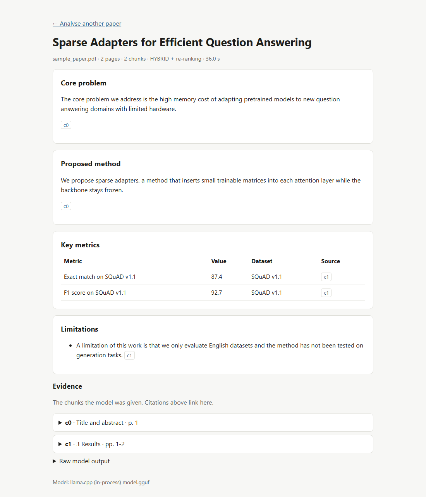
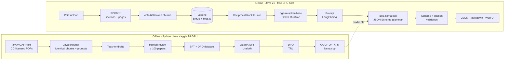
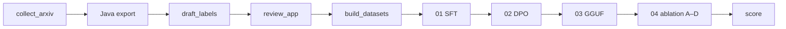

<div align="center">

# GRASP-SLM

**Grounded Retrieval-Augmented Structured Paper analysis with a Small Language Model**

Structured, citation-backed analyses of research papers from a 1.5B-parameter model that runs on a free CPU.

[](https://github.com/Mihiran-Thilakarathna/GRASP-SLM/actions/workflows/ci.yml)


[](LICENSE)

[Overview](#overview) · [How it works](#how-it-works) · [Quick start](#quick-start) · [API](#rest-api) · [Research](#research-design) · [Training](#training-pipeline) · [Project structure](#project-structure)

</div>

---

## Overview

Literature reviews keep asking the same four questions of every paper: *what problem, what method,
what results, what limitations?* General chatbots answer them inconsistently: they misreport numbers,
change their output format between requests, and need paid APIs.

GRASP-SLM separates the two jobs:

- **Fine-tuning controls *how* the model answers.** QLoRA SFT teaches a fixed JSON schema, and DPO teaches it to prefer grounded answers over plausible fabrications.
- **Retrieval controls *what* it says.** Hybrid BM25 + dense retrieval with re-ranking supplies the exact sentences, numbers and dataset names, each tagged with its page.

<table>
<tr><td>

**Output for every paper**

- 🎯 **Core problem**
- 🛠️ **Proposed method**
- 📊 **Key metrics**: metric, value, dataset
- ⚠️ **Limitations**

Every claim cites the chunk and page it came from.

</td><td>

**Engineering guarantees**

- JSON is **always parseable**: decoding is constrained by a grammar compiled from the JSON Schema
- Every answer is **validated** against the schema, and any citation outside the retrieved context is flagged
- Runs **fully on CPU** as a 4-bit GGUF; no paid API anywhere

</td></tr>
</table>

<p align="center">
  <br>
  <sub>Web interface on a demo paper, base model on a laptop CPU (36 s). Citations link to the evidence chunks.</sub>
</p>

<details>
<summary><b>Example response</b> (<code>POST /api/analyze</code>, same demo paper, abridged)</summary>

```json
{
  "title": "Sparse Adapters for Efficient Question Answering",
  "schemaValid": true,
  "unknownCitations": [],
  "analysis": {
    "core_problem": {
      "text": "The core problem we address is the high memory cost of adapting pretrained models to new question answering domains with limited hardware.",
      "citations": ["c0"]
    },
    "proposed_method": {
      "text": "We propose sparse adapters, a method that inserts small trainable matrices into each attention layer while the backbone stays frozen.",
      "citations": ["c0"]
    },
    "key_metrics": [
      { "metric": "Exact match on SQuAD v1.1", "value": "87.4", "dataset": "SQuAD v1.1", "citations": ["c1"] },
      { "metric": "F1 score on SQuAD v1.1",    "value": "92.7", "dataset": "SQuAD v1.1", "citations": ["c1"] }
    ],
    "limitations": [
      { "text": "A limitation of this work is that we only evaluate English datasets and the method has not been tested on generation tasks.", "citations": ["c1"] }
    ]
  },
  "context": [ { "id": "c1", "section": "3 Results", "pageStart": 1, "pageEnd": 2, "text": "…" } ],
  "timingsMs": { "parse": 122, "chunk": 2, "retrieve": 5810, "generate": 27079, "total": 33029 }
}
```

</details>

## How it works

The project has two halves, in different languages by design. Models are trained in Python, where
the training libraries exist, and served from a JVM backend, as is common in industry. The halves
share only **model files** and the contract in [`shared/`](shared/) (JSON Schema, prompts, field queries),
so training and inference can never drift apart.



**Retrieval, one paper at a time.** Each output field has its own query
([`field_queries.json`](shared/field_queries.json)). BM25 (exact terms and numbers) and bge-small-en-v1.5
vectors (meaning) each return 20 candidates. Reciprocal Rank Fusion merges them, a cross-encoder re-ranks
the top 10, and a round-robin pick gives every field evidence before any field gets a second chunk
(4–6 chunks in total).

### Tech stack

| Layer | Technology |
|---|---|
| Base model | Qwen2.5-1.5B-Instruct (Apache 2.0) |
| Fine-tuning | Unsloth · Hugging Face TRL · PEFT · bitsandbytes (QLoRA NF4, rank 16) |
| Preference optimisation | DPO on grounded vs. perturbed answers |
| PDF ingestion | Apache PDFBox 3 |
| Hybrid retrieval | Apache Lucene 10 (BM25 text field + HNSW vector field) |
| Embeddings · re-ranking | bge-small-en-v1.5 · bge-reranker-base on ONNX Runtime (LangChain4j) |
| LLM inference | java-llama.cpp (in-process GGUF) or any OpenAI-compatible server |
| Validation | networknt json-schema-validator |
| API · UI | Spring Boot 3.5 · Thymeleaf |
| Evaluation | Ragas · BERTScore · custom numeric accuracy |
| Build · CI · Deploy | Maven · JUnit 5 · pytest · GitHub Actions · Docker · Hugging Face Spaces |

## Quick start

### Docker (recommended)

```bash
docker build -t grasp-slm .
docker run -p 7860:7860 grasp-slm
```

Open <http://localhost:7860>. The image bundles the retrieval models and the base Qwen2.5-1.5B GGUF.
To bundle the fine-tuned model instead:

```bash
docker build -t grasp-slm \
  --build-arg LLM_REPO=<hf-user>/grasp-slm-gguf \
  --build-arg LLM_FILE=grasp-slm-dpo-q4_k_m.gguf .
```

### From source

Requires Java 21+ and Python 3.10+ (Python is only used to download models).

```bash
python -m venv .venv && .venv/Scripts/pip install huggingface_hub     # Linux/macOS: .venv/bin/pip
.venv/Scripts/python scripts/download_models.py                       # ~2.4 GB into models/
cd app && ./mvnw -q -DskipTests package && cd ..
java -jar app/target/grasp-slm.jar                                    # http://localhost:7860
```

### Configuration

| Variable | Default | Purpose |
|---|---|---|
| `GRASP_LLM_BACKEND` | `llamacpp` | `llamacpp` (in-process GGUF), `openai` (HTTP server), `none` |
| `GRASP_LLM_MODEL_PATH` | `models/llm/model.gguf` | GGUF file for the in-process backend |
| `GRASP_LLM_BASE_URL` | `http://localhost:8081/v1` | OpenAI-compatible endpoint for the `openai` backend |
| `GRASP_LLM_THREADS` | auto | CPU threads for llama.cpp |
| `GRASP_RETRIEVAL_MODE` | `HYBRID` | `HYBRID`, `DENSE` or `BM25` |
| `GRASP_RERANK` | `true` | cross-encoder re-ranking |
| `PORT` | `7860` | HTTP port |

All settings: [`application.yml`](app/src/main/resources/application.yml).

## REST API

| Method | Path | Description |
|---|---|---|
| `POST` | `/api/analyze` | Full analysis of a PDF (multipart `file`) |
| `POST` | `/api/retrieve` | Retrieval only: chunks and per-field rankings, no generation |
| `GET` | `/api/schema` | The output JSON Schema |
| `GET` | `/api/health` | Status, loaded model, retrieval defaults |

Optional parameters for `analyze` and `retrieve`: `retrieval=hybrid|dense|bm25`, `rerank=true|false`,
`maxContextChunks=1..12`, `includePrompt=true`.

```bash
curl -F file=@paper.pdf "http://localhost:7860/api/analyze?retrieval=hybrid"
```

The response includes the analysis, rendered Markdown, the exact chunks the model saw, per-field
rankings, schema and citation validation, token counts, a per-stage latency breakdown and peak memory.
That is everything the evaluation needs.

## Research design

| | Research question |
|---|---|
| **RQ1** | How much does hybrid retrieval (BM25 + dense) improve context recall and numeric accuracy over dense-only retrieval? |
| **RQ2** | How much does QLoRA SFT improve schema validity and answer quality over prompting the base model? |
| **RQ3** | Does DPO on grounded vs. hallucinated pairs increase faithfulness beyond SFT alone? |
| **RQ4** | How much quality does 4-bit GGUF quantisation cost, and what CPU latency is achieved? |

**Ablation study.** Every configuration is scored on the same held-out, human-verified test papers
with the same judge model and prompts.

| ID | Model | Retrieval | Tests |
|---|---|---|---|
| A | Base, F16 | dense only | baseline |
| B | Base, F16 | hybrid + re-ranker | RQ1 |
| C | SFT, F16 | hybrid + re-ranker | RQ2 |
| D | SFT + DPO, F16 | hybrid + re-ranker | RQ3 |
| E | SFT + DPO, **Q4_K_M on CPU** | hybrid + re-ranker | RQ4 |

All five use the same llama.cpp engine, prompt and grammar, so only the component under test changes.

**Metrics:** Ragas faithfulness, answer relevancy, context precision and recall · BERTScore F1 ·
JSON-schema validity · numeric accuracy (grounded precision and reference recall of reported values) ·
citation validity · latency and peak memory.

### Results

> 🧪 Training and evaluation in progress. This table is generated by `python -m grasp_train.score`
> into [`results/summary.md`](results/).

| Config | Schema validity | Numeric F1 | BERTScore F1 | Faithfulness | Context recall | CPU latency |
|---|---|---|---|---|---|---|
| A | – | – | – | – | – | – |
| B | – | – | – | – | – | – |
| C | – | – | – | – | – | – |
| D | – | – | – | – | – | – |
| E | – | – | – | – | – | – |

## Training pipeline



| Step | Command / notebook | Runs on |
|---|---|---|
| 1. Collect papers | `python -m grasp_train.collect_arxiv --per-field 100` | local |
| 2. Chunk + retrieve | `java -jar app/target/grasp-slm.jar export --input data/pdfs --output data/export.jsonl` | local |
| 3. Teacher drafts | `python -m grasp_train.draft_labels --base-url … --model …` | free API |
| 4. Human review | `python -m grasp_train.review_app` | local |
| 5. Datasets | `python -m grasp_train.build_datasets` → Hugging Face Hub | local |
| 6. QLoRA SFT | [`01_sft_qlora.ipynb`](training/notebooks/01_sft_qlora.ipynb) | Kaggle T4 |
| 7. DPO | [`02_dpo.ipynb`](training/notebooks/02_dpo.ipynb) | Kaggle T4 |
| 8. GGUF + Q4_K_M | [`03_export_gguf.ipynb`](training/notebooks/03_export_gguf.ipynb) | Kaggle CPU |
| 9. Ablation A–D | [`04_ablation_eval.ipynb`](training/notebooks/04_ablation_eval.ipynb) | Kaggle T4 |
| 10. Config E + scoring | `run_eval --config E` · `python -m grasp_train.score --ragas` | local CPU |

DPO rejected answers are automatic, targeted perturbations of the verified answer: **altered number**,
**invented metric**, **missing citation**, **malformed JSON**. Notebooks push checkpoints to the Hub,
so an interrupted free GPU session resumes where it stopped.

The step-by-step runbook is in [YOUR_STEPS.md](YOUR_STEPS.md).

## Project structure

```
GRASP-SLM/
├── shared/                     # contract shared by Java and Python
│   ├── analysis.schema.json    #   output JSON Schema (also compiled into the decoding grammar)
│   ├── prompt/                 #   system and user prompt templates
│   └── field_queries.json      #   per-field retrieval queries
├── app/                        # online application (Java 21, Spring Boot)
│   └── src/main/java/lk/ac/rjt/grasp/
│       ├── ingest/             #   PDFBox parsing, section detection, chunking
│       ├── retrieval/          #   Lucene index, RRF, hybrid retriever
│       ├── llm/                #   java-llama.cpp and OpenAI-compatible clients
│       ├── prompt/  schema/    #   prompt building, validation, Markdown rendering
│       ├── service/  web/      #   pipeline service, REST API, Thymeleaf UI
│       └── cli/                #   `export` command for building training data
├── training/                   # offline pipeline (Python)
│   ├── grasp_train/            #   collection, labelling, review, datasets, metrics, scoring
│   ├── notebooks/              #   Kaggle/Colab notebooks (generated from notebooks/src)
│   └── tests/
├── scripts/                    # model download and Hugging Face Space deployment
├── Dockerfile                  # 3-stage image: build jar → fetch models → JRE runtime
└── .github/workflows/ci.yml    # Maven verify · pytest · Docker build
```

## Testing

```bash
cd app && ./mvnw verify                      # 29 JUnit tests: ingestion, retrieval, validation, REST + UI
cd app && ./mvnw test -Pmodels               # end-to-end with the real ONNX and GGUF models
cd training && python -m pytest -q           # 12 tests: datasets, DPO perturbations, metrics
```

The fast suites use a synthetic PDF and deterministic fake models, so they run in CI without downloads.

## Scope and limitations

English arXiv papers, analysed one at a time. Text, tables and equations are read as text; figures are not
interpreted. Two-column layouts and maths-heavy papers are harder to parse and are reported as a
limitation. The model is constrained to answer only from the retrieved context, so anything retrieval
misses cannot appear in the answer.

## Author

**T. H. Mihiran Thilakarathna**, Rajarata University of Sri Lanka

## License

Code is released under the [Apache License 2.0](LICENSE). Qwen2.5-1.5B-Instruct is Apache 2.0;
bge-small-en-v1.5 and bge-reranker-base are MIT. Source papers keep their own Creative Commons licences,
recorded per paper in `data/metadata.jsonl`.
